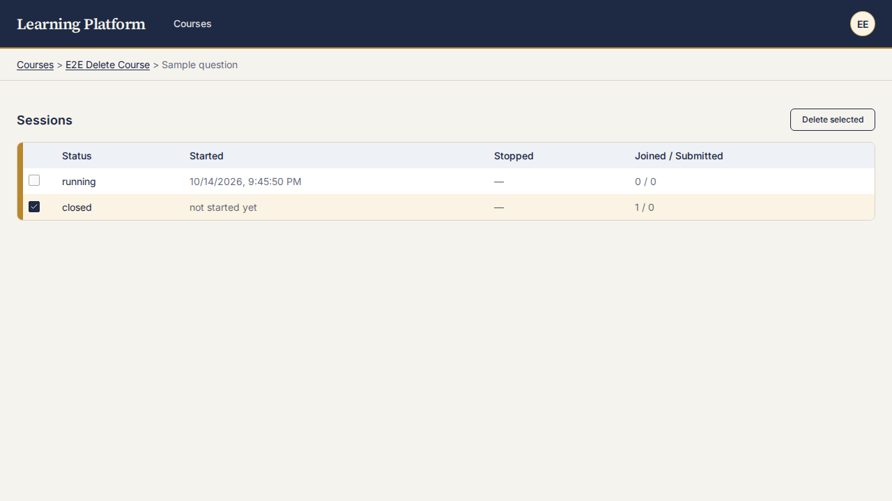
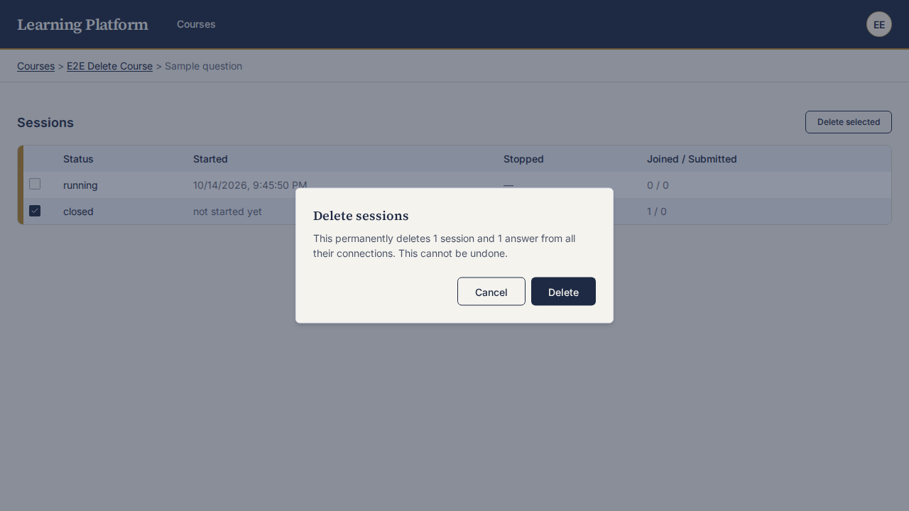

ID: SESSION-DELETE-001

Status: DONE — accepted at sprint review 2026-10-14

Priority: High

Effort: 5

As:
a `Trainer`

I want to:
delete one or several `Quiz Session`s at once, after a confirmation
(renamed from the placeholder ID `TRAINER`)

So that:
I can get rid of test sessions, throwaway sessions, wrongly created sessions, etc.

Definition of Done:
* the session list shows a checkbox per `Quiz Session` and a "Delete selected" button, enabled only when at least one is selected
* a `Quiz Session` with status `running` has a disabled checkbox and cannot be selected
* clicking "Delete selected" opens a confirmation dialog stating how many sessions and the total number of answers (across all their `Connection`s) will be removed
* confirming hard-deletes the sessions, their `Connection`s and answers permanently, then refreshes the list; cancelling changes nothing
* the delete API rejects any `running` session with an error and deletes nothing from the request (all-or-nothing)
* the delete is restricted to sessions of the Trainer's own `Tenant`
* unit tests cover the API (running rejected, tenant isolation, cascade, answer count); e2e covers select, dialog count, confirm
* a real-browser screenshot of the list and the dialog is attached under `assets/SESSION-DELETE-001/`

Implementation plan (sprint planning 2026-10-14):
* Scope: checkboxes live on `QuizSessionHistoryPage` (`/quizzes/:quizId/sessions`), i.e. per quiz. This replaces "session list" in the DoD above. Status `running` is blocked; `closed` and `stopped` are deletable.
* ADR: no new ADR. Drizzle/Postgres per ADR-0002/0003; new shadcn `Dialog` and `Checkbox` components copied into `client/src/components/ui/` per ADR-0006 (adds `@radix-ui/react-dialog` and `@radix-ui/react-checkbox`).
* Persistence: FKs are `ON DELETE no action` and stay that way (no migration). New repository method deletes in one Drizzle transaction, in order: `quiz_session_answers`, `quiz_session_connections`, `quiz_sessions`. Scoping by tenant uses the existing join `quiz_sessions.quizId -> quizzes.courseId -> courses.tenantId`.
* API: `POST /api/quizzes/:quizId/sessions/delete` with body `{ sessionIds: string[], dryRun?: boolean }`, behind `sessionMiddleware`. With `dryRun: true` it returns `{ sessionCount, answerCount }` and deletes nothing (feeds the dialog). Otherwise it deletes and returns the same counts. 409 `{ error: 'session_running' }` if any selected session is `running` (derived status, via `deriveStatus`); 404 if any id is not in this quiz and tenant; nothing is deleted on any error.
* Client: checkbox column in the history table (disabled for `running`), "Delete selected" button, `Dialog` showing the dry-run counts, confirm then refetch the list.
* Tests: repository/route tests (running rejected, other tenant 404, cascade order, counts, all-or-nothing); component test for the page; new e2e spec; screenshots saved to `assets/SESSION-DELETE-001/`.
* Risk: the `running` check and the delete must happen in the same transaction (lock the session rows) so a session cannot start between the check and the delete.

Implemented (2026-10-14):
* `server/src/db/quizSessions.ts`: `deleteForQuiz` runs in one transaction. It locks the selected session rows (`FOR UPDATE`), scopes them to quiz and tenant, and returns `not_found` or `running` without deleting. Otherwise it counts the answers and, unless `dryRun`, deletes answers, connections, then sessions. No migration.
* `server/src/routes/quizSessions.ts`: `POST /api/quizzes/:quizId/sessions/delete`. Returns 400 for a bad body, 404 for a not-found or malformed id, 409 `session_running`, and 200 with `{ sessionCount, answerCount }`.
* Client: new `ui/checkbox.tsx` and `ui/dialog.tsx` (added `@radix-ui/react-checkbox` and `@radix-ui/react-dialog`). `QuizSessionHistoryPage` has a checkbox column (disabled for `running`), a "Delete selected" button, and a confirm dialog fed by the dry run. The list refreshes after a delete.
* Verification: server suite 230 passed, client suite 111 passed, `tsc` clean, full e2e 13 passed on the disposable stack. The new `e2e/quiz-session-delete.spec.ts` ran against real Postgres. It covers a connection with an answer, a running session that cannot be selected, cancel, and confirm.
* Known gap: the real repository's SQL (locking and cascade order) is only covered by that e2e spec, not by DB-free unit tests. The fake in `testSupport/fakes.ts` mirrors it through a `cascade` hook.
* Evidence:  
