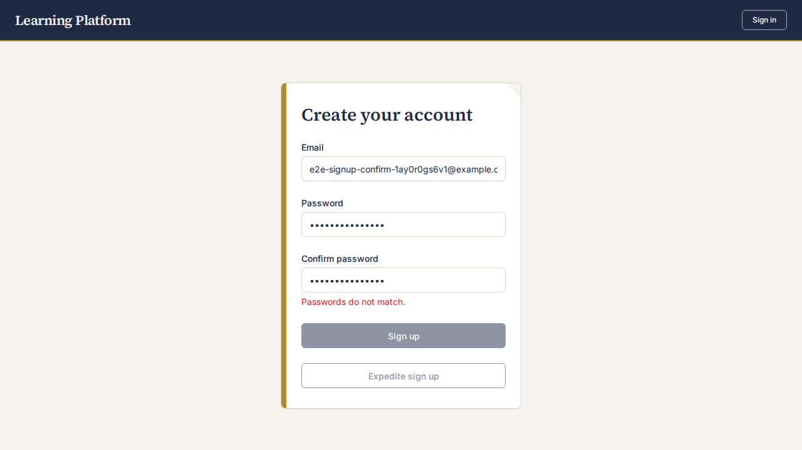

ID: SIGNUP-002

Status: DONE — accepted at sprint review 2026-10-14

Priority: High

Effort: 2

As:
an `unregistered user`

I want to:
type the password I want for my new account twice

So that:
I'm more sure I didn't misspell it

Definition of Done:
* the sign-up form has a "Confirm password" field below the password field
* on blur of the confirm field and on submit, if the two values differ, an inline error appears under the confirm field and the submit button is disabled while they differ
* when the values match, the error disappears and sign-up proceeds as before
* the sign-up API requires a confirmation value and rejects a mismatch with a 400 and no account is created
* unit tests cover the server rejection and the form validation; e2e spec covers a mismatch then a match
* a real-browser screenshot of the mismatch error state is attached under `assets/SIGNUP-002/` (per do_and_donts)

Implementation plan (sprint planning 2026-10-14):
* No new ADR: stays within ADR-0004 (bcryptjs, react-router) and ADR-0006 (shadcn/ui `Input`/`Label`).
* Client (`client/src/SignUpPage.tsx`): add `confirmPassword` state and a "Confirm password" field. Mismatch error shown on blur of the confirm field and on submit; submit button disabled while the values differ. Both existing fetches (`/api/signup` and `/api/signup/expedite`) send `passwordConfirmation`.
* Server (`server/src/routes/signup.ts`): both `POST /api/signup` and `POST /api/signup/expedite` read `passwordConfirmation` and return 400 `{ error: 'password_mismatch' }` when it is missing or differs, checked before hashing. Existing `password_too_short` check stays first.
* Tests: extend `SignUpPage.test.tsx`, add route tests for both endpoints, extend `client/e2e/signup.spec.ts` (mismatch, then match). Existing signup tests, helpers and `scripts/seed.sh`/`db-seed.ts` callers that post to signup must send the new field (blast-radius check).

Implemented (2026-10-14):
* `server/src/routes/signup.ts`: both signup endpoints return 400 `password_mismatch` when `passwordConfirmation` is missing or differs. It is checked after `password_too_short` and before hashing.
* `client/src/SignUpPage.tsx`: "Confirm password" field, inline error on blur and on submit, both submit buttons disabled while the values differ. Both fetches send `passwordConfirmation`.
* Blast radius: `server/scripts/db-seed.ts`, `client/e2e/helpers.ts` and `client/e2e/login.spec.ts` updated to send or fill the new field. The e2e selectors for "Password" now use `exact: true`.
* Verification: server suite 222 passed, client suite 107 passed, `tsc` clean, `e2e/signup.spec.ts` 2 passed on the disposable stack.
* The e2e match step uses "Expedite sign up" because the e2e stack has no SMTP, so the normal sign-up returns `internal_error` there. This was already true before this PBI.
* Evidence: 
